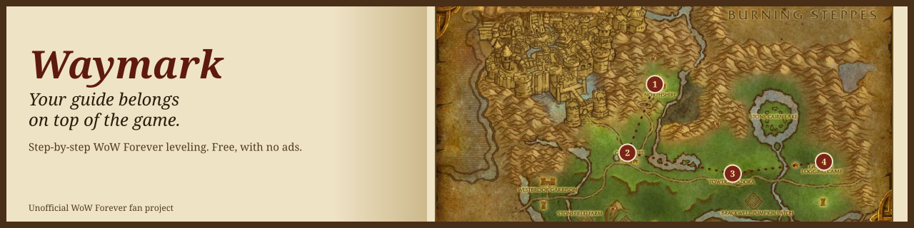
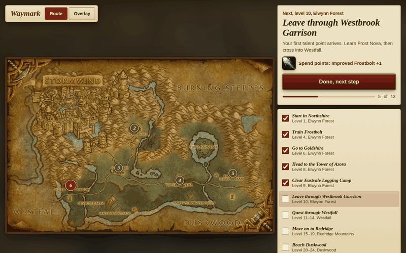
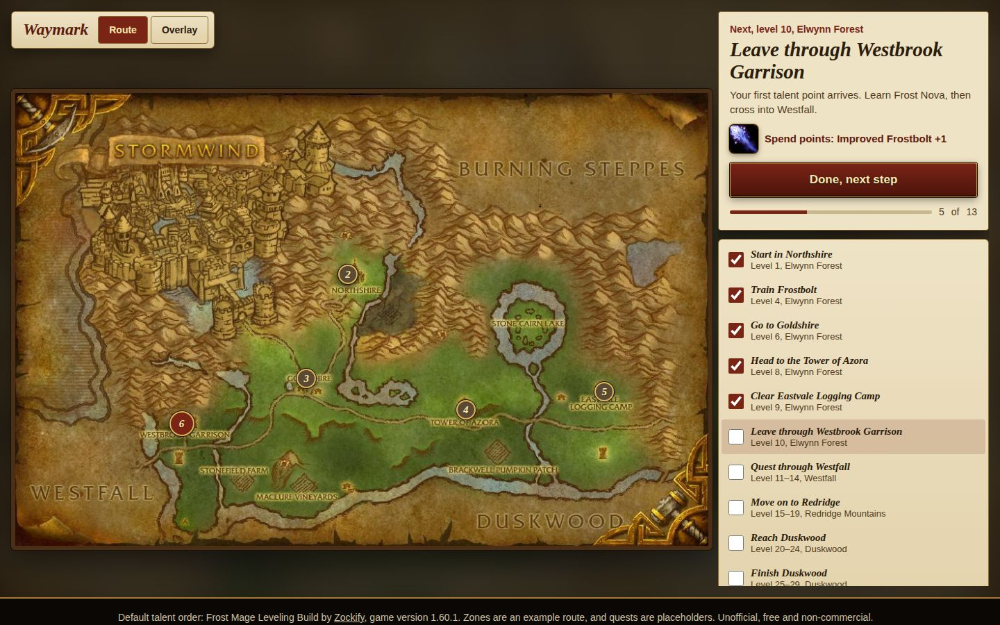
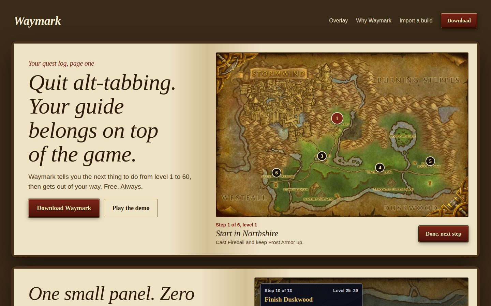

  
  
  
  

<a href="https://waymark.lol"><b>Website</b></a> &nbsp;|&nbsp; <a href="https://waymark.lol/downloads/Waymark-setup.exe"><b>Download for Windows</b></a>

## Quest: Quit Alt-Tabbing

*You have opened a leveling guide in a browser for the fourth time tonight. You died while reading it. Find a better way.*

**Objectives**

- See the next thing to do, without leaving the game
- Follow talents from the build you actually chose
- Keep your place when you log off

**Reward:** a free guide with no ads.

## How it works

Waymark gives you one step at a time. Finish it, press **Done**, and the next one is already there.

Here's the example route, with talents from the Frost Mage Leveling Build:

| Levels | Where | Spend points on |
|---|---|---|
| 10–14 | Westfall |  Improved Frostbolt |
| 20–24 | Duskwood |  Ice Lance, Precision, Ice Shards |
| 25–29 | Duskwood |  Shatter, Ice Block, Ice Shards |
| 30–39 | Stranglethorn Vale |  Fingers of Frost, Cold Snap and more |
| 40–52 | The Hinterlands |  Ice Barrier, then Arcane |

## One small panel

The overlay keeps your current step and your next talent on top of the game. Shrink it to a single line, fade it, or move it out of the way. No second monitor required.

The overlay shown here is a design, drawn over a map that stands in for the game window.

## Your build, on your route

Paste a talent calculator link, and every step updates with the right talents for that build.

| Link format | What happens today |
|---|---|
| Talent calculator links | Mage links convert and update the route |
| Export strings and build codes | Two known Mage builds update the route |
| Forum and guide links | Recognizes the link, with no conversion yet |

## See the rest

<table>
  <tr>
    <td></td>
    <td></td>
  </tr>
</table>

## FAQ

<b>Why not just buy a guide addon?</b>

 
Good guide addons can cost $25 to $50, and many of them are excellent. Waymark is for players who want a free guide that follows the build they already picked.

<b>Can I download it today?</b>

 
Yes. The Windows build is a single `Waymark-setup.exe`, linked at the top of this page and in [releases](../../releases/latest). No account, no installer.

<b>Are the quests real?</b>

 
Yes — the routes and quest lists ship with the app and cover every starting zone.

<b>Is this made by Blizzard?</b>

 
No. Waymark is an unofficial fan project. Blizzard didn't make it and doesn't endorse it.

<b>A step looks wrong. What should I do?</b>

 
<a href="../../issues">Open an issue</a> with the level, the zone and what you expected to see.

## Credits

The default talent order comes from the WoW Forever Builds library, kept current for WoW Forever Season 1.

## License and rights

Waymark is a free, non-commercial, unofficial fan project. It isn't affiliated with or endorsed by Blizzard Entertainment.

World of Warcraft and Blizzard Entertainment are trademarks or registered trademarks of Blizzard Entertainment, Inc. All game assets and all rights to them belong to Blizzard Entertainment, Inc. Read [LICENSE-ASSETS.md](LICENSE-ASSETS.md) for details.

The project's own code and design are released under MIT.
